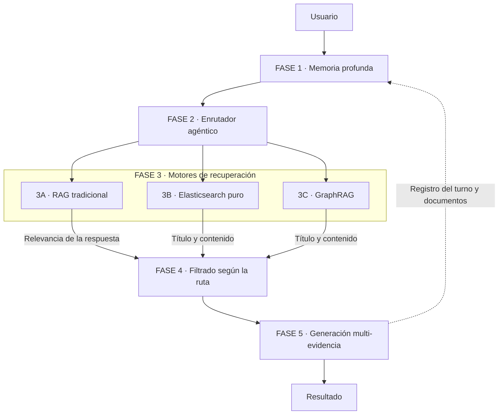

## Diagrama de arquitectura

## Componentes

- **Memoria profunda:** mantiene el contexto de la conversación mediante resúmenes acumulativos, turnos recientes y metadatos de documentos relacionados, que hemos denominado *subgrafo activo*. Esto ayuda a recordar información de consultas anteriores y gestionar conversaciones largas. El subgrafo activo pertenece a la memoria de la sesión y es independiente del grafo de recuperación de Neo4j.

- **Enrutador agéntico:** genera un borrador hipotético y combina reglas para los casos claros con la clasificación de un LLM. Recibe la consulta reformulada por la memoria y, según si se solicitan (A) datos concretos, (B) listados por metadatos o (C) relaciones entre normas citadas, selecciona el motor de recuperación más adecuado.

- **Motores de recuperación:** permiten obtener información mediante tres estrategias diferentes.
  - **RAG tradicional:** esta opción estaba previamente implementada por el equipo de Imaxin. Se integra mediante la API de Lynx, que devuelve una respuesta, su URL y los fragmentos utilizados para responder preguntas específicas.
  - **Elasticsearch puro:** extrae con un LLM los filtros de la consulta, valida sus campos y valores y busca por entidad, sección, subsección, fecha, idioma e identificadores. Recupera todos los fragmentos coincidentes; el pipeline los agrupa por `file_id` y conserva hasta 20 publicaciones y dos fragmentos por publicación para la generación. El idioma es opcional y los recuentos exhaustivos de publicaciones únicas siguen pendientes.
  - **GraphRAG:** utiliza Neo4j para buscar las normas citadas en la pregunta y recuperar sus relaciones directas, a un salto, mediante consultas Cypher de solo lectura. Está integrado en el pipeline y probado con un driver simulado; su validación contra el grafo real sigue pendiente.

- **Filtro antirruido y comprobación de contenido:** en la ruta A, una clasificación binaria evalúa si la respuesta de Lynx es relevante, utilizando los fragmentos como contexto. En las rutas B y C se comprueba que los documentos tengan título y contenido, conservando las coincidencias de metadatos o las relaciones del grafo sin aplicar el filtro temático del LLM. Esta fase evalúa relevancia o disponibilidad de contenido, no la veracidad jurídica de la información.

- **Generación multi-evidencia:** utiliza un LLM para elaborar respuestas a partir de múltiples fragmentos seleccionados, incluso cuando proceden de documentos diferentes. Solicita citas con el formato `[Doc N, Chunk M]`, títulos y URLs cuando estén disponibles. Si la llamada falla o devuelve texto vacío, conserva el borrador, que puede no estar verificado. En la ruta B, si la respuesta omite títulos de las publicaciones seleccionadas, el pipeline devuelve el listado construido con los resultados recuperados. La corrección general de las afirmaciones y citas no se valida automáticamente.

- **Servicios compartidos:** las llamadas directas a los modelos se centralizan en `_call_llm`, usando Ollama mediante LiteLLM. La configuración está en `src/config.py` y Langfuse proporciona trazabilidad opcional. Son servicios transversales a las cinco fases.

## Flujo entre componentes

1. El **usuario** envía una consulta asociada a una sesión.
2. La **memoria profunda** aporta el contexto y reformula las preguntas de seguimiento como consultas autónomas.
3. El **enrutador agéntico** combina reglas y un LLM para elegir uno de los tres **motores de recuperación**, que obtiene las fuentes correspondientes.
4. La respuesta de Lynx pasa por el **filtro de relevancia**. Los resultados de Elasticsearch y GraphRAG se agrupan y se comprueba que tengan título y contenido.
5. Los documentos seleccionados llegan al módulo de **generación multi-evidencia**, que solicita una respuesta con referencias. En la ruta B se comprueba además la presencia de los títulos del listado seleccionado y se recupera ese listado si el modelo los omite.
6. Se registran el turno completado y los metadatos de los documentos en la **memoria profunda**, y se devuelve el **resultado** al usuario.
